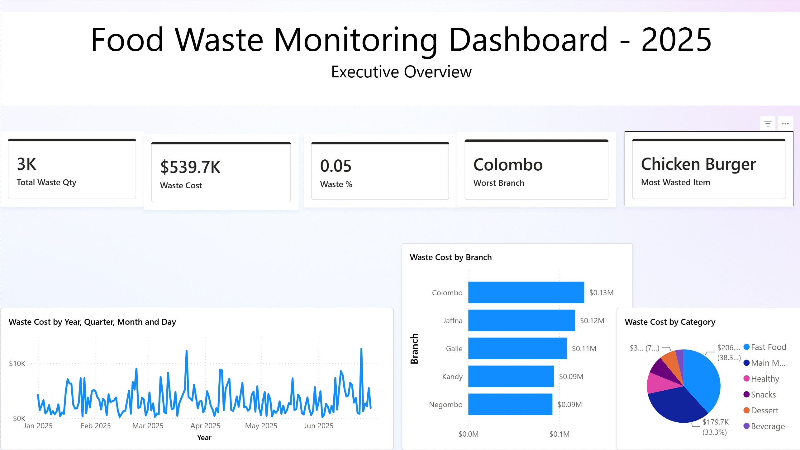
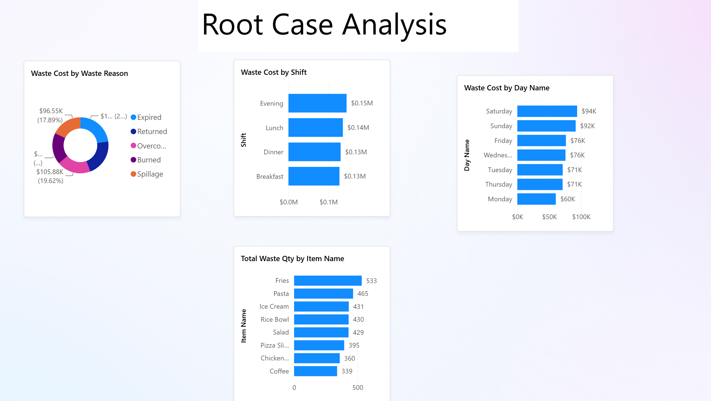
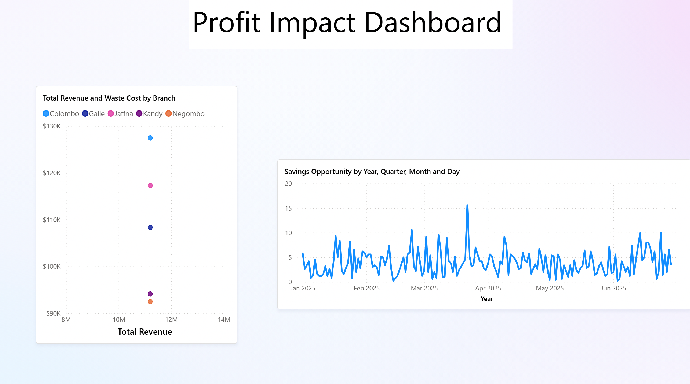
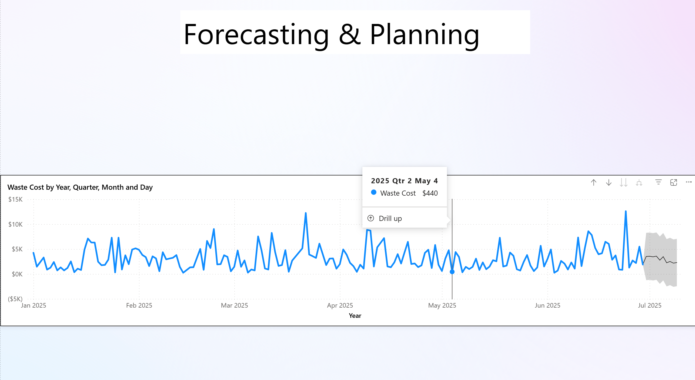

# In-Class Activity – Food Waste Monitoring Dashboard

## Overview
An in-class Power BI activity focused on building a food waste monitoring solution for a restaurant chain to analyze waste, identify root causes, evaluate financial impacts, and forecast future waste.

## Activities
- Imported and cleaned datasets using Power Query.
- Built a star-schema data model using fact and dimension tables.
- Created DAX measures for waste quantity, waste cost, waste percentage, and potential savings.
- Developed four dashboard pages:
  - **Executive Overview** – Waste KPIs and trends by branch and category.
  - **Root Cause Analysis** – Waste reasons, shifts, days, and top wasted items.
  - **Profit Impact** – Potential revenue loss and savings opportunities.
  - **Forecasting & Planning** – Predicted future waste using Power BI forecasting.

## Dashboard Screenshots

### Executive Overview

### Root Cause Analysis

### Profit Impact

### Forecasting & Planning

